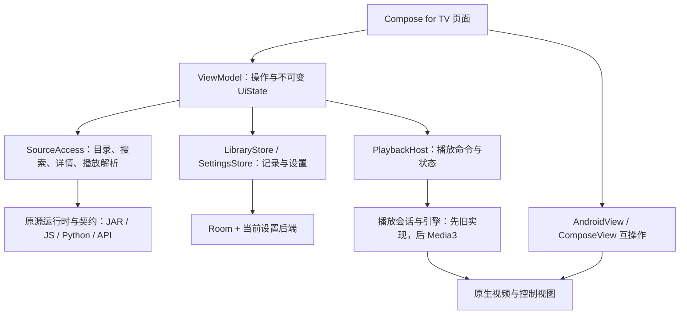

# TV 现代化重写方案：保持现有 UI，借鉴 AVBox 的演进路线

状态：用户于 2026-10-12 授权按计划执行，P1 / P2 通过，P3 核心功能通过，P4 进行中；性能与完整设备验收待完成。原始方案与验收约束保留，阶段结果追加到对应任务。

## 1. 目标与成功标准

保留当前 TV 的外观、布局和电视使用习惯，逐步将内部实现演进为 Kotlin、Compose for TV、ViewModel / StateFlow、协程请求与独立播放会话。以 AVBox 的演进方法为参考，以 TVBoxOS 的现有功能和操作为行为基准。

成功需要同时满足：现有 UI 可对照；核心功能与遥控器可用；Android 9+ / ARMv7 保留；源兼容与播放能力没有被架构迁移裁掉。没有 ARMv7 真机时，交付只能标记阶段验证通过，不能宣布全部验收完成。

产品身份保持 TV / com.coke.tv，正式安装为空壳，不预置订阅、站点、解析接口或测试影片。不迁移 AVBox / TVBoxOS 等其他应用的数据；同包升级时保留 TV 自己的设置、历史与收藏，内部存储切换需要单独验证。

“保持 UI”具体指顶部导航 C、推荐大图与信息并列、继续观看、详情和选集布局、搜索左侧键盘、配色、字体层级、圆角、间距、选中态及已有操作入口。使用 TV 控件不会自动采用其默认外观。模糊、透明叠层和复杂动效不进入本次目标。

当前辅助页面仍有较多上游布局。迁移先复现实际原生画面；它们的完整视觉统一沿用此前设计另行评审，不借迁移擅自改变布局或删功能。

## 2. 已有基线与参考

| 对象 | 固定点与用途 |
| --- | --- |
| 当前 TV | a2f5494：应用实现与已交付 APK；d1cf993：Android TV 模拟器与测试工具；作为迁移回退点 |
| TVBoxOS | ab11d289e09963a9daf65ca7f6b7a9a8cbe184e1；功能、源契约与遥控器基准 |
| AVBox | b0c4eecf42ca03c2cb035f9d63685d92de4a39c5 / 1.2.4；Kotlin、Compose、StateFlow、服务托管播放的演进参考 |
| FongMi/TV | c616c0aa3613e87529791587a9f71b78c278c991；电视与播放服务按具体问题只读对照 |

当前已验证：ARMv7 / ARM64 Debug 构建和包内容；Android TV 13 ARM64 的空壳、导航、搜索、固定视频、媒体键暂停恢复、历史与订阅首页。外部线路、直播、ARMv7 真机和音频未完成全面验证，不能把这些未知项算成迁移后已经保持的能力。详见 [现有验证记录](../../docs/VALIDATION.md)。

已有原生截图复制为 [候选视觉基线](baseline/README.md)，P1 补齐后冻结验收集。HTML 留在 [设计档案](../design/README.md)，不重新选择 A / B / C。

## 3. 保留、替换与兼容边界

| 范围 | 迁移方式 | 保留内容 |
| --- | --- | --- |
| 首页、搜索、详情、历史、收藏、设置 | 按页替换 Compose + ViewModel，复用共同主题和组件 | 现有布局、功能入口、导航含义、数据与操作结果 |
| 点播控制与视频画面 | 初期通过 View 互操作嵌入；后续引擎独立，控制视图继续原生 | VodController / PlayFragment 的成熟命令、快进、返回、选集与线路逻辑 |
| 直播 | 保留原 LivePlayActivity / 控制视图；先统一外层状态与接口，按区域换皮 | 频道、分组、线路、EPG、回看及遥控器操作，以实际可用基线为准 |
| 源兼容 | 先包住现有 SourceViewModel / ApiConfig，随后逐个加载模块拆分 | CatVod JAR、JS、Python、XML / JSON、type 4 分支、proxy 与请求头等已支持行为 |
| 源契约层 | 默认继续 Java，允许长期保留 | 包名、类名、字段、静态方法、继承与反射签名、宿主依赖 |
| 播放内核 | 先沿用旧引擎；独立阶段加入 Media3 adapter | IJK、外部播放器等现有能力在替代完成前保持可用 |
| 历史 / 收藏 | Room 保留，先收口访问，再按需升级 | sourceKey + vodId 等现有记录标识与存档语义 |
| 设置 | 先建立统一存储访问，底层沿用 Hawk | 旧键的缺省值、类型、设置联动及同包升级数据 |

迁移终态是主要页面、状态与业务协调使用 Kotlin / Compose。必要的原生视频、电视控制视图和 Java 契约层可以长期存在，不以文件语言统一率作为完成指标。

## 4. 架构与接口

先在 app 内按职责组织 package，不先拆出大量 Gradle 模块。已有 player、quickjs、pyramid 在调用方替代和验证完成前保留。

这是拟议架构，不表示这些接口已经实现。设计采用深模块：Module 的复杂行为藏在小 Interface 后；Seam 位于页面业务与源 / 播放 / 存储实现的交界；旧实现和候选新实现通过 Adapter 接入。只为真实替换点建立接口，不把每个函数包装一层。

- `SourceAccess`：负责站点目录、列表、搜索、详情和播放解析。调用方只提交站点与请求，获得带请求归属的结果；缓存、取消、超时、解析、源实例与线程限制留在内部。过渡 adapter 调用原源链，避免同时重写源协议。
- `LibraryStore`：历史 / 收藏的读写与观察，沿用现有标识；Room 细节不进入页面。
- `SettingsStore`：类型明确的设置快照与变更操作。区分缺键和已存缺省值，复杂值显式编码；页面不直接读 Hawk / MMKV。
- `PlaybackHost`：会话状态、有限命令和画面接入 / 解绑协议。播放源解析只走一条链；控制视图与页面不各维护一套真实播放状态。

每页维护一个不可变 `UiState`，包括 loading / content / empty / error、选中站点与内容等页面状态；一次性导航 / 提示走事件。进度更新只影响相关控件，不让整页高频重绘。页面通过生命周期感知的订阅收集状态。

协程迁移保留源调用线程约束。取消页面请求后，用请求代次 / 站点标识拒绝过期结果；阻塞式第三方 JAR 调用未必可被协程立即中断，不能把取消 Job 当作已经停止底层调用。需要有界执行与明确错误结果。

## 5. UI 与遥控器策略

Google 的迁移路径支持 Compose 与 Views 共存，并按页替换；电视页面优先采用 Compose for TV 的控件，按当前主题覆盖其外观，避免混用手机 / TV Material 的默认主题。[官方迁移策略](https://developer.android.com/develop/ui/compose/migrate/strategy)、[TV Compose 指南](https://developer.android.com/training/tv/playback/compose)。

复用分为两件事：播放器 / 直播按键处理可以继续交给原控制视图；页面控件换成 Compose 后，原 RecyclerView 的焦点代码不能原封不动驱动新控件。新页面使用官方 TV 控件的方向导航，仅补必要的跨区域入口与返回恢复，不另建全局焦点管理器。

事件由当前活动区域处理一次：播放区先交原控制器；已处理事件不再交 Compose 执行第二遍；未处理事件才进入页面 / 系统默认链。Compose 与嵌入 View 之间明确焦点进入、离开与返回位置，隐藏区域不能截获按键。

以下仍用 View 互操作保留：原 SearchKeyboard、选集或频道列表、播放器和难以低成本保持操作的区域。使用 AndroidView 的创建 / 更新 / 释放时机保持宿主稳定，重组不重建播放器；Fragment 互操作只作为迁移过渡。[官方 View 互操作](https://developer.android.com/develop/ui/compose/migrate/interoperability-apis/views-in-compose)。

遇到导航回退时先复用该区域的原 View，登记尚未迁移的区域，再继续其他页面。不得为追求“纯 Compose”扩展成遥控器框架项目。改变既定操作、裁掉功能或整区域重做需要单独提出具体方案。

视觉 token 从当前 XML 颜色、字体、尺寸和截图提取。当前 mm / AutoSize 的数值不直接当 dp 照抄，先对照 720p / 1080p 的实际位置与尺寸。播放控制层可以保持当前 XML，UI 保持不变不要求控件全部换成 Compose。

## 6. 依赖与 ARMv7 前置检查

不整体复制 AVBox 的版本目录、ARM64 限制、手机权限与 SDK 配置。JDK 17、现有 SDK / 模拟器优先复用；确需升级的工具按环境规范记录路径、空间与清理。

| 项目 | 方案与前置检查 |
| --- | --- |
| 构建链 | 当前 AGP 7.2.2 / Gradle 7.5 只作为回退基线；P1 选择满足 Compose / Kotlin / Chaquopy 的兼容组合，再锁定精确版本，非“全部升级最新版” |
| Python | 当前 Chaquopy 12 / Python 3.8；官方表显示 Chaquopy 12 对应 AGP 4.1–7.2，不能直接拖到新 AGP。候选 Chaquopy 16.1 支持 Python 3.8，先保持运行时与依赖语义，再验证插件升级。升级方案仍需实际构建与源测试 |
| ARMv7 Python | 官方当前说明：Python 3.11 及以前支持 32 位，3.12+ 只支持 64 位。保留 ARMv7 与所需 wheels 是版本选择硬条件，不能通过去掉 Python flavor 获得构建通过 |
| QuickJS / JNI / FFmpeg / IJK | 检查 AAR / APK 中真实 ABI 与原生依赖，不能仅看 abiFilters；测试 JNI 加载和执行。没有 ARMv7 库的候选版本不能替换原实现 |
| Compose for TV | 在 Android 9+ 范围内选定兼容版本；TV 组件的主题、缩放和焦点样式按现有 UI 配置 |
| Media3 | 单独阶段选定核心与解码扩展的兼容版本。首轮不替换渲染、内核和所有源加载链三者 |
| MMKV | AVBox 当前 2.x 不能直接照搬，官方已移除 32 位支持。默认先保留 Hawk adapter；后续优先评估无 ABI 风险的 SharedPreferences 后端。确需 MMKV 时只评估包含 ARMv7 的 1.3.x LTS 实际产物，不自维护 JNI 分支 |
| SDK 与应用身份 | minSdk 28 与 com.coke.tv 保持；compile / target 升级引起的权限、媒体服务限制需单列验证，不顺带改变产品兼容下限 |

来源：[Chaquopy 版本兼容表](https://chaquo.com/chaquopy/doc/current/versions.html)、[Chaquopy ABI / Python 说明](https://chaquo.com/chaquopy/doc/current/android.html)、[MMKV 官方安装说明](https://github.com/Tencent/MMKV/wiki/android_setup)。这些资料核对了兼容边界，不构成候选构建组合已经通过的证据。

## 7. 实施顺序与阶段出口

授权执行后按顺序推进，每阶段有可安装 Debug 包与记录。用户已授权执行；任务状态表示当前阶段位置，按依赖与完成条件推进。

| 阶段 / 本地任务 | 改动与交付 | 完成条件 |
| --- | --- | --- |
| P1 [基线与构建链](issues/01-baseline-and-toolchain.md) | 冻结截图、功能表、按键路线，建立可回退代码点；加入 Kotlin / Compose 构建能力，锁版本 | Python32 / Python64 都通过；源 / JNI 固定样本通过；原 UI 和播放器未改，环境记录完整 |
| P2 [状态与源接口](issues/02-state-and-source-interface.md) | 先收口 SourceAccess / LibraryStore / SettingsStore，新增 Kotlin 状态和 ViewModel，旧界面继续可用 | 加载、空态、错误、取消及换源过期结果验证；源契约不变，UI 不直接操作后端 |
| P3 [Compose 首页试点](issues/03-compose-home.md) | 主题、胶囊、推荐大图、继续观看；新首页仍打开旧详情 / 播放 | 720p / 1080p 浅深色与基线相符；方向 / 确认 / 返回可用；不重写播放器；提供首个对照包 |
| P4 [点播页面迁移](issues/04-compose-vod-pages.md) | 详情、搜索、历史、收藏逐页迁移；原视频、控制层、键盘按需嵌入 | 点播闭环、焦点返回位置、选集 / 换线 / 进度与历史 / 收藏语义一致；每页分别对照 |
| P5 [设置与直播接入](issues/05-settings-and-live.md) | 设置页面与直播外层状态 / UI 接入；保留原频道及控制视图 | 每个原功能有映射；配置、频道 / 分组 / 线路 / EPG / 回看与返回按可用基线验证 |
| P6 [播放所有权独立](issues/06-playback-service.md) | 在旧内核上先建立服务托管会话与挂摘协议 | 预览 ↔ 全屏不重建会话、不双播；退出停止与落盘语义保持；无 Activity / View 泄漏；媒体键单次执行 |
| P7 [Media3 接入](issues/07-media3-adapter.md) | 加入 Media3 adapter，在固定样本和真实线路上与旧实现对照 | Android 9+ / 双 ABI、请求头 / proxy / 嗅探、格式与控制操作通过；IJK / 外部播放器能力保留；不足则继续旧默认 |
| P8 [存储与内部 Kotlin 收敛](issues/08-storage-and-kotlin-consolidation.md) | 按需更换设置后端；源加载模块与内部协调逐个 Kotlin 化；清理已被替代代码 | TV 自身数据可升级；JAR / JS / Python 契约与执行通过；没有双写、重复所有者或无调用旧入口 |
| P9 [完整验收](issues/09-final-acceptance.md) | 页面 / 功能映射、性能对照、ARMv7 真机、剩余兼容 View 说明与最终 Debug 包 | 全部硬条件有证据；没有设备或线路不可用的项目明确待验收，不以模拟器代替 |

三个评审里程碑：P3 先看到保持原样的 Compose 首页；P5 得到主要页面现代化但沿用成熟播放的可用版本；P9 完成内部演进与整机验收。不承诺固定工期；P1 解决依赖组合后，根据实测难点更新工作量。

## 8. 播放服务与内核的具体约束

“服务托管”指服务拥有会话和引擎，页面拥有显示与交互视图；服务不持有 Activity 或页面 View。保留原 VodController 的交互逻辑，通过命令桥接引擎，逐步解除它对旧 VideoView 的耦合。不能把带 Activity 上下文的整个 PlayFragment / VodController 直接放进 Service。

P6 先保留旧内核验证所有权，P7 再接 Media3，避免同时改变生命周期和解码行为。每个会话只有一个真实内核和解析所有者；预览与全屏移交同一会话。直播接管明确停止 / 保存点播状态，返回行为沿用当前基线，不自动新增后台播放、画中画或预加载。

AVBox 当前使用普通 Service + MediaSessionCompat；TV 不必逐字复制。P6 优先评估官方 MediaSessionService，同时检查旧引擎适配与权限成本，若保留兼容会话更稳，则记录差异。两条路径都必须验证 Android 9 与当前 TV 模拟器的媒体按键、服务生命周期和退出行为。[官方服务生命周期参考](https://developer.android.com/media/media3/session/background-playback)。

退出播放页面时停止 / 暂停、保存进度和释放策略以 P1 的行为表为准；服务所有权与页面所有权分离，不等于允许离开页面后继续播放。

## 9. 验证、性能与回退

每一组代码变更立即运行相关 Debug 构建和必要测试，不在最后堆积验证。接口 / 状态 / 源解析 / 生命周期变化写能触达真实路径的测试；静态视觉调整用截图对照，不为简单样式堆镜像单测。

| 验证层 | 证据与通过条件 |
| --- | --- |
| 构建与包 | Python32 + Python64 Debug；API 28、包名、精确 ABI、QuickJS / Python / 解码库、无预置源 / 测试订阅、签名验证 |
| 源接口 | 固定 XML / JSON / type 4、JAR / JS / Python 自有样本；目录、列表、搜索、详情、解析与 proxy；错误 / 超时 / 过期结果分别验证 |
| 视觉 | 固定内容、主题、尺寸与页面状态；并排图 + 关键元素位置 / 字号 / 折行 / 间距核对。动态时钟与视频进度排除；不能只验首页 |
| 遥控器 | 顶部 ↔ 内容、返回原位置、跨 Compose / View、搜索键盘、预览 ↔ 全屏、控制层、播放 / 暂停 / 快进 / 选集 / 换线、直播分组 / 频道 / 返回 |
| 媒体 | 自制含音频的固定 MP4 / HLS；请求头、重定向、proxy 与嗅探样本；暂停、恢复、seek、自动下一集、异常重试。外部订阅单列结果 |
| 数据 / 生命周期 | 同包升级设置 / 历史 / 收藏，页面重建、前后台、服务重启、源切换取消和退出释放；避免双播 / 重复落盘 |
| 设备 / 性能 | 现有 API 30 Android 与 API 33 Android TV ARM64 对照；Android 9+ ARMv7 实体设备必测，补音频和真实遥控器 |

性能先测基线再设门槛：同设备、同内容、同构建模式至少五次，记录冷启动到可操作、列表滑动卡顿、稳态内存、播放掉帧与退出后的资源。建议相对门槛为首屏耗时 / 稳态内存中位数不超过基线 20%；这是待 P1 测量方法锁定的验收建议，不是现有性能数据。调试包指标只与同类调试包比较，不当作 Release 性能结论。

回退按页面 / adapter 保留最近一个通过版本。迁移开关仅供 Debug 对照，不出现用户模式选择，不改变默认源与设置；每次只选择一个会话 / 存储写入所有者。没有真实替换需要时，不新增开关或长期双栈。

旧入口在替代功能、契约测试与设备验证通过后才删除；不直接清空源码重建。每阶段做独立本地提交，保留上游出处与许可；未经授权不推送、发布或运行 Release。

## 10. 本轮交付与下一步

本轮交付此方案、九张本地任务与原生候选基线；应用源码、依赖、APK 和运行环境未改，没有启动服务。原 `.scratch/android-tv/` 保留为首包记录；其后续视觉 / 验收票与本方案关联，避免两条实现路线同时推进。

用户已授权从 P1 开始执行。当前无需决定每个依赖的最终版本；P1 的第一项产物就是经实际双 ABI 构建验证的版本组合。技术目标已明确，待补事实包括 ARMv7 实体设备、外部线路 / 直播可用样本以及低端设备性能基线。
